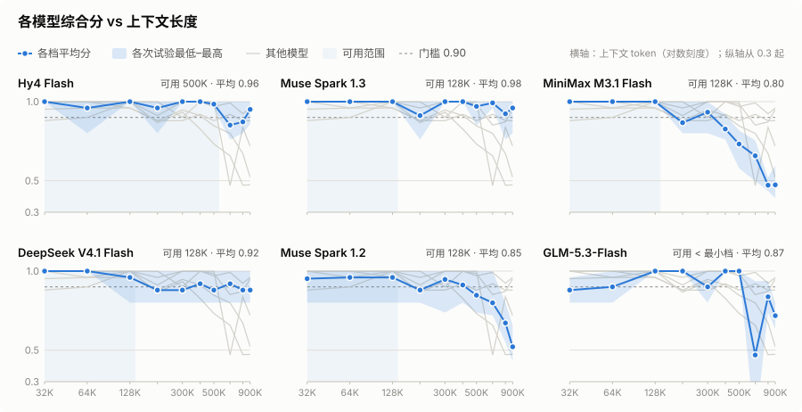

# ctxbench：日常任务模型的“实际可用上下文”测试

厂商标称的上下文是 100 万 token，不代表塞满 100 万还能好好干活。这个项目从很长的上下文开始，**逐档往下降**，
用一组日常难度的问题看模型在每一档还能不能答对，最后给出两个可以直接填进配置的数字：

- **推荐上下文**：这一档以及所有更短的档位，每次都满分。适合拿来做低难度、量大、不想出错的日常任务。
- **可用上限**：这一档以及所有更短的档位，平均分 ≥ 0.90 且单次最差 ≥ 0.80。超过它，模型开始明显漏信息。

榜单按“可用上限”排序。这两个数字都要求“所有更短的档位也达标”，某一档出现一次低分就会把整条阶梯截断，所以榜单另附**全档平均**（各档平均分的均值），用来看整体水平。

所有请求都经由本机的 [opencode](https://opencode.ai) 发出，所以**你在 opencode 里能用的任何供应商和模型都能测**：
OpenCode Go / Zen 订阅、Anthropic、OpenAI、OpenRouter、自建的 OpenAI 兼容接口、本地 llama.cpp 等等。

## 榜单

<!-- LEADERBOARD:START -->


| # | 模型 | 思考档 | 推荐上下文<br>（全部满分） | 可用上限<br>（均分≥0.90 且单次≥0.80） | 全档平均 | 每档次数 | 测试日期 |
|---:|---|---|---:|---:|---:|---:|---|
| 1 | Hy4 Flash<br><sub>`opencode-go/hy4-flash-free`</sub> | high | **32K** | **500K** | 0.958 | 5 | 2026-11-16 |
| 2 | Muse Spark 1.3<br><sub>`opencode-go/muse-spark-1.3-contributor`</sub> | xhigh | **128K** | **128K** | 0.976 | 5 | 2026-11-16 |
| 3 | MiniMax M3.1 Flash<br><sub>`opencode-go/minimax-m3.1-flash`</sub> | max | **128K** | **128K** | 0.796 | 3 | 2026-11-16 |
| 4 | DeepSeek V4.1 Flash<br><sub>`opencode-go/deepseek-v4.1-flash`</sub> | max | **64K** | **128K** | 0.920 | 5 | 2026-11-16 |
| 5 | Muse Spark 1.2<br><sub>`opencode-go/muse-spark-1.2-contributor`</sub> | xhigh | **< 最小档** | **128K** | 0.845 | 5 | 2026-11-16 |
| 6 | GLM-5.3-Flash<br><sub>`opencode-go/glm-5.3-flash`</sub> | max | **< 最小档** | **< 最小档** | 0.870 | 2 | 2026-11-16 |

各档综合分（每格为各次试验的平均；— 表示未测或请求失败；<sup>×n</sup> 表示该格次数少于该模型的常规次数）：

| 模型 | 900K | 800K | 650K | 500K | 400K | 300K | 200K | 128K | 64K | 32K |
|---|---:|---:|---:|---:|---:|---:|---:|---:|---:|---:|
| Hy4 Flash | 0.95 | 0.87 | 0.85 | 0.98 | 1.00 | 1.00 | 0.96 | 1.00 | 0.96 | 1.00 |
| Muse Spark 1.3 | 0.96 | 0.92 | 0.99 | 0.97 | 1.00 | 1.00 | 0.91 | 1.00 | 1.00 | 1.00 |
| MiniMax M3.1 Flash | 0.47 | 0.47 | 0.66 | 0.73 | 0.83 | 0.93 | 0.87 | 1.00 | 1.00 | 1.00 |
| DeepSeek V4.1 Flash | 0.88 | 0.88 | 0.92 | 0.88 | 0.92 | 0.88 | 0.88 | 0.96 | 1.00 | 1.00 |
| Muse Spark 1.2 | 0.52 | 0.67 | 0.80 | 0.85 | 0.91 | 0.95 | 0.88 | 0.96 | 0.96 | 0.95 |
| GLM-5.3-Flash | 0.72 | 0.84 | 0.47 | 1.00 | 1.00 | 0.90 | 1.00 | 1.00 | 0.90 | 0.88 |

逐档明细（检索漏掉的深度、空回答、耗时等）见 [results/report.md](results/report.md)。
<!-- LEADERBOARD:END -->

## 测的是什么

每次请求是一份“工作记录归档”：几十万行彼此很像的服务日志、会议纪要、待办、聊天、资产登记、签到记录。
归档末尾问四类问题，模型只需输出一个 JSON：

| 题型 | 内容 | 考察点 | 权重 |
|---|---|---|---:|
| 检索 | 10 台设备的资产码，均匀埋在 5%–95% 深度 | 单点查找，看哪个深度开始丢 | 0.40 |
| 更新 | 4 台设备先登记、后被“更正通知”改码 | 能否取最新值而不是先看到的值 | 0.25 |
| 计数 | 某人的签到记录一共几条（5–9 条，散布全文） | 全文聚合 | 0.20 |
| 规则 | 归档第一行规定的答题规则 | 开头指令是否还被记得 | 0.15 |

- 干扰项与目标格式完全相同（同样有上百条资产登记和更正通知），不能靠“找唯一的那句话”取巧。
- 同一档位、同一次试验，所有模型拿到的题目内容相同（同一个随机种子）。
- 归档长度按各模型自己的分词器换算：先用 `calibrate` 实测每个模型的 token/字符 比例，所以“200K”对每个模型都约等于 20 万 token。
- 默认每个模型用它的**最高思考档**，测的是能力上限；想测日常实际用的档位，在 `config.json` 里改 `variant` 即可。

## 快速开始

需要 Python 3.9+（只用标准库）和已经登录好供应商的 opencode。

```bash
git clone https://github.com/shuiyue-cmyk/ctxbench.git
cd ctxbench
```

1. 编辑 `config.json`，写上要测的模型（格式与 `opencode models` 输出一致）：

   ```json
   {
     "rungs": [900000, 800000, 650000, 500000, 400000, 300000, 200000, 128000, 64000, 32000],
     "trials": 3,
     "concurrency": 0,
     "models": [
       { "model": "opencode-go/glm-5.3-flash", "variant": "max", "name": "GLM-5.3-Flash" },
       { "model": "openrouter/some-vendor/some-model", "variant": "high", "name": "Some Model", "max_context": 256000 }
     ]
   }
   ```

   - `variant`：opencode 里的思考档（`low` / `high` / `max` / `xhigh` 等，因模型而异），不需要可省略。
   - `max_context`：可选，大于它的档位直接跳过（比如模型本身只有 256K）。
   - `rungs`：起点和档位随意定；没必要从 100 万开始，可以从标称上限的 90% 左右起步，给思考和输出留出空间。

2. 校准、跑测试、出报告：

   ```bash
   python ctxbench.py calibrate
   ```

   ```bash
   python ctxbench.py run
   ```

   ```bash
   python ctxbench.py report
   ```

`run` 每完成一次请求就追加一行到 `results/raw.jsonl`，中断后再运行会跳过已完成的格子；只想补测某个模型或档位：

```bash
python ctxbench.py run --models opencode-go/glm-5.3-flash --rungs 64000 32000 --trials 1
```

`report` 会生成 `results/report.md`（逐档明细）、`results/chart.svg`（每个模型一格的分面折线图，带各次试验的最低–最高色带），并刷新本 README 的榜单区块。

## 它怎么调用 opencode

- 通过 `opencode api GET /api/info` 找到 opencode 后台服务的地址，然后直接向服务的 `POST /api/experimental/generate/text` 发送整份归档。这是一次无状态的生成，不带 agent 的系统提示和工具，不会写入会话列表。
- 服务的密码从 `~/.config/opencode/service.json` 读取；也可以用环境变量 `OPENCODE_SERVER_URL`、`OPENCODE_SERVER_PASSWORD` 指定别的服务。
- 找 opencode 可执行文件的顺序：`OPENCODE_CLI` 环境变量 → `PATH` 里的 `opencode` / `opencode-cli` → Windows 桌面版自带的 CLI。
- 校准用的是 `opencode run --format json` 返回的输入 token 数（短消息与长样本之差 ÷ 字符数）。
- 所有（模型 × 档位 × 次数）的格子放进同一个线程池并发发出，长档位先发。并发数由 `config.json` 的 `concurrency` 控制，`0` 表示全部同时发出；供应商有并发或速率限制时调小即可。5xx、429、超时、空回答会等 30 秒自动重试，最多 3 次。

## 注意事项

- 每档默认跑 3 次，单次结果仍有运气成分，看“可用上限”要结合逐档明细里的“最差一次”。从首轮结果看，失分大多来自计数题，检索和更新题错得少得多。
- 当前榜单各模型的每档次数不同：DeepSeek V4.1 Flash、Muse Spark 1.3、Muse Spark 1.2、Hy4 Flash 为 5 次，MiniMax M3.1 Flash 为 3 次，GLM-5.3-Flash 为 2 次（见榜单“每档次数”列）。次数越多，“推荐上下文”越严格也越可信；GLM 的失分集中在短上下文的计数题，排名受偶然误差影响较大。
- 档位长度是按校准比例换算的，实际 token 数可能有百分之几的偏差。
- 结果反映的是“经由该供应商、在测试当天”的表现。同一个模型换供应商、换思考档，结果都可能不同。
- 题目是中文的工作记录；英文或代码为主的上下文，表现可能不一样。
