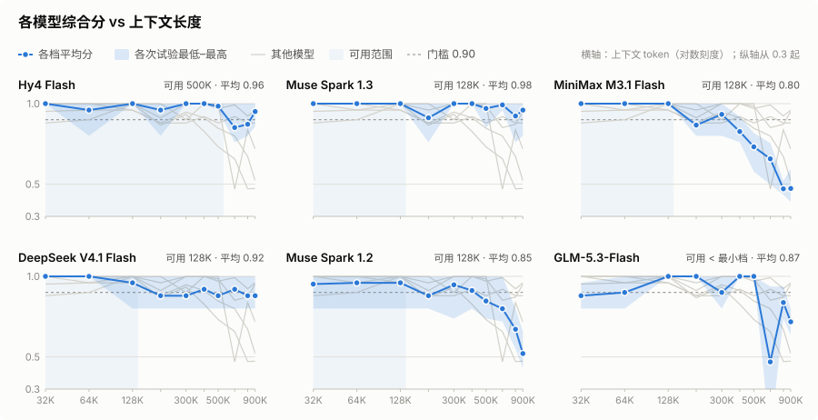

# 详细结果

综合分 = 检索×0.4 + 更新×0.25 + 计数×0.2 + 开头规则×0.15。

| # | 模型 | 思考档 | 推荐上下文 （全部满分） | 可用上限 （均分≥0.90 且单次≥0.80） | 每档次数 | 测试日期 |
|---:|---|---|---:|---:|---:|---|
| 1 | Muse Spark 1.3 `opencode-go/muse-spark-1.3-contributor` | xhigh | **400K** | **650K** | 3 | 2026-11-11 |
| 2 | DeepSeek V4.1 Flash `opencode-go/deepseek-v4.1-flash` | max | **64K** | **200K** | 3 | 2026-11-11 |
| 3 | MiniMax M3.1 Flash `opencode-go/minimax-m3.1-flash` | max | **128K** | **128K** | 3 | 2026-11-11 |
| 4 | GLM-5.3-Flash `opencode-go/glm-5.3-flash` | max | **< 最小档** | **< 最小档** | 2 | 2026-11-11 |

各档综合分（每格为各次试验的平均；— 表示未测或请求失败；×n 表示该格次数少于该模型的常规次数）：

| 模型 | 900K | 800K | 650K | 500K | 400K | 300K | 200K | 128K | 64K | 32K |
|---|---:|---:|---:|---:|---:|---:|---:|---:|---:|---:|
| Muse Spark 1.3 | 1.00 | 0.87 | 1.00 | 0.95 | 1.00 | 1.00 | 1.00 | 1.00 | 1.00 | 1.00 |
| DeepSeek V4.1 Flash | 0.93 | 0.93 | 0.93 | 0.87 | 0.87 | 0.87 | 0.93 | 0.93 | 1.00 | 1.00 |
| MiniMax M3.1 Flash | 0.47 | 0.47 | 0.66 | 0.73 | 0.83 | 0.93 | 0.87 | 1.00 | 1.00 | 1.00 |
| GLM-5.3-Flash | 0.72 | 0.84 | 0.47 | 1.00 | 1.00 | 0.90 | 1.00 | 1.00 | 0.90 | 0.88 |

## DeepSeek V4.1 Flash（`opencode-go/deepseek-v4.1-flash`，思考档 max）

| 上下文 | 次数 | 综合 | 检索 | 更新 | 计数 | 规则 | 最差一次 | 平均耗时 | 备注 |
|---:|---:|---:|---:|---:|---:|---:|---:|---:|---|
| 900K | 3 | 0.93 | 1.00 | 1.00 | 0.67 | 1.00 | 0.80 | 144s |  |
| 800K | 3 | 0.93 | 1.00 | 1.00 | 0.67 | 1.00 | 0.80 | 201s |  |
| 650K | 3 | 0.93 | 1.00 | 1.00 | 0.67 | 1.00 | 0.80 | 139s |  |
| 500K | 3 | 0.87 | 1.00 | 1.00 | 0.33 | 1.00 | 0.80 | 116s |  |
| 400K | 3 | 0.87 | 1.00 | 1.00 | 0.33 | 1.00 | 0.80 | 127s |  |
| 300K | 3 | 0.87 | 1.00 | 1.00 | 0.33 | 1.00 | 0.80 | 113s |  |
| 200K | 3 | 0.93 | 1.00 | 1.00 | 0.67 | 1.00 | 0.80 | 101s |  |
| 128K | 3 | 0.93 | 1.00 | 1.00 | 0.67 | 1.00 | 0.80 | 84s |  |
| 64K | 3 | 1.00 | 1.00 | 1.00 | 1.00 | 1.00 | 1.00 | 150s |  |
| 32K | 3 | 1.00 | 1.00 | 1.00 | 1.00 | 1.00 | 1.00 | 76s |  |

## Muse Spark 1.3（`opencode-go/muse-spark-1.3-contributor`，思考档 xhigh）

| 上下文 | 次数 | 综合 | 检索 | 更新 | 计数 | 规则 | 最差一次 | 平均耗时 | 备注 |
|---:|---:|---:|---:|---:|---:|---:|---:|---:|---|
| 900K | 3 | 1.00 | 1.00 | 1.00 | 1.00 | 1.00 | 1.00 | 73s |  |
| 800K | 3 | 0.87 | 0.90 | 0.92 | 0.67 | 1.00 | 0.76 | 68s | 检索漏掉深度 7%,64%,77%；用了旧码 1 次 |
| 650K | 3 | 1.00 | 1.00 | 1.00 | 1.00 | 1.00 | 1.00 | 64s |  |
| 500K | 3 | 0.95 | 1.00 | 1.00 | 1.00 | 0.67 | 0.85 | 36s |  |
| 400K | 3 | 1.00 | 1.00 | 1.00 | 1.00 | 1.00 | 1.00 | 44s |  |
| 300K | 3 | 1.00 | 1.00 | 1.00 | 1.00 | 1.00 | 1.00 | 39s |  |
| 200K | 3 | 1.00 | 1.00 | 1.00 | 1.00 | 1.00 | 1.00 | 26s |  |
| 128K | 3 | 1.00 | 1.00 | 1.00 | 1.00 | 1.00 | 1.00 | 17s |  |
| 64K | 3 | 1.00 | 1.00 | 1.00 | 1.00 | 1.00 | 1.00 | 24s |  |
| 32K | 3 | 1.00 | 1.00 | 1.00 | 1.00 | 1.00 | 1.00 | 9s |  |

## MiniMax M3.1 Flash（`opencode-go/minimax-m3.1-flash`，思考档 max）

| 上下文 | 次数 | 综合 | 检索 | 更新 | 计数 | 规则 | 最差一次 | 平均耗时 | 备注 |
|---:|---:|---:|---:|---:|---:|---:|---:|---:|---|
| 900K | 3 | 0.47 | 0.27 | 0.33 | 0.67 | 1.00 | 0.39 | 187s | 检索漏掉深度 3%,5%,12%,16%,16%,22%,23%,26%,32%,35%,36%,43%,43%,46%,56%,58%,72%,74%,82%,86%,96%,98% |
| 800K | 3 | 0.47 | 0.33 | 0.75 | 0.00 | 1.00 | 0.43 | 353s | 检索漏掉深度 3%,4%,7%,17%,17%,18%,23%,28%,34%,37%,45%,46%,47%,58%,64%,65%,68%,74%,76%,84% |
| 650K | 3 | 0.66 | 0.63 | 0.75 | 0.33 | 1.00 | 0.50 | 160s | 检索漏掉深度 13%,16%,22%,36%,37%,54%,56%,65%,72%,77%,78% |
| 500K | 3 | 0.73 | 0.77 | 0.83 | 0.33 | 1.00 | 0.58 | 245s | 检索漏掉深度 3%,24%,26%,46%,57%,63%,72%；用了旧码 1 次 |
| 400K | 3 | 0.83 | 0.90 | 1.00 | 0.33 | 1.00 | 0.76 | 74s | 检索漏掉深度 16%,37%,48% |
| 300K | 3 | 0.93 | 1.00 | 1.00 | 0.67 | 1.00 | 0.80 | 39s |  |
| 200K | 3 | 0.87 | 1.00 | 1.00 | 0.33 | 1.00 | 0.80 | 37s |  |
| 128K | 3 | 1.00 | 1.00 | 1.00 | 1.00 | 1.00 | 1.00 | 22s |  |
| 64K | 3 | 1.00 | 1.00 | 1.00 | 1.00 | 1.00 | 1.00 | 39s |  |
| 32K | 3 | 1.00 | 1.00 | 1.00 | 1.00 | 1.00 | 1.00 | 13s |  |

## GLM-5.3-Flash（`opencode-go/glm-5.3-flash`，思考档 max）

| 上下文 | 次数 | 综合 | 检索 | 更新 | 计数 | 规则 | 最差一次 | 平均耗时 | 备注 |
|---:|---:|---:|---:|---:|---:|---:|---:|---:|---|
| 900K | 2 | 0.72 | 0.95 | 0.75 | 0.00 | 1.00 | 0.64 | 286s | 检索漏掉深度 96%；用了旧码 1 次 |
| 800K | 2 | 0.84 | 1.00 | 0.75 | 0.50 | 1.00 | 0.74 | 64s | 用了旧码 2 次 |
| 650K | 2 | 0.47 | 0.50 | 0.38 | 0.50 | 0.50 | 0.00 | 211s | 检索漏掉深度 3%,16%,23%,35%,43%,53%,66%,78%,82%,93%；用了旧码 1 次；空回答 1 次 |
| 500K | 2 | 1.00 | 1.00 | 1.00 | 1.00 | 1.00 | 1.00 | 112s |  |
| 400K | 2 | 1.00 | 1.00 | 1.00 | 1.00 | 1.00 | 1.00 | 341s |  |
| 300K | 2 | 0.90 | 1.00 | 1.00 | 0.50 | 1.00 | 0.80 | 215s |  |
| 200K | 2 | 1.00 | 1.00 | 1.00 | 1.00 | 1.00 | 1.00 | 225s |  |
| 128K | 2 | 1.00 | 1.00 | 1.00 | 1.00 | 1.00 | 1.00 | 47s |  |
| 64K | 2 | 0.90 | 1.00 | 1.00 | 0.50 | 1.00 | 0.80 | 154s |  |
| 32K | 2 | 0.88 | 0.95 | 1.00 | 0.50 | 1.00 | 0.80 | 202s | 检索漏掉深度 22% |
